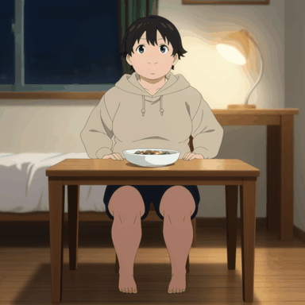

**English** · [简体中文](README.zh-CN.md)

# comfyui-apng-motion

[](https://github.com/Gg22333/comfyui-apng-motion/actions/workflows/ci.yml)
[](https://github.com/Gg22333/comfyui-apng-motion/releases)
[](LICENSE)
[](pyproject.toml)

Make **24-frame, coherent APNG / WebP / GIF** animations in ComfyUI by interpolating three to five
keyframes in latent space — no frame-by-frame scripts, no per-frame image dumps, one queue → three files.



---

## Contents

- [At a glance](#at-a-glance)
- [Why not `batch_size`](#why-not-batch_size)
- [Quick start](#quick-start)
- [Where files land](#where-files-land)
- [Requirements](#requirements)
- [Repository layout](#repository-layout)
- [How it works](#how-it-works)
- [Documentation](#documentation)
- [Limits](#limits)
- [Contributing](#contributing)
- [Credits](#credits)
- [License](#license)

---

## At a glance

| | |
| --- | --- |
| **Input** | 3–5 keyframe prompts (a "story card": lock + style + per-beat actions) |
| **Engine** | ComfyUI + `LatentInterpolate` ×24 + `ImageBatchMulti` |
| **Output** | APNG, WebP and GIF — one file each, 24 frames, loop infinite |
| **Models** | any: SDXL checkpoint or Moss/DiT stack (loader-agnostic) |
| **Scripts** | pure stdlib + Pillow, no GPU needed for tooling |
| **Runs on** | Windows / macOS / Linux; paths come from `profiles/*.json` |

## Why not `batch_size`

`batch_size=24` produces **24 independent noise samples**. A fixed seed makes the run reproducible,
not continuous — playback flickers. This project instead pins every keyframe to the *same* first-frame
latent, so hair colour, eye colour and composition do not drift:

```
first frame (denoise 1.0, fixed seed)
   ├─ keyframe A (img2img from the first latent, denoise 0.4/0.5)
   ├─ keyframe B … (same latent)
   └─ keyframe C … (optional, 4–5 beats)
24 × LatentInterpolate → 24 × VAEDecode → ImageBatchMulti(24)
   ├─ SaveAnimatedPNG
   ├─ SaveAnimatedWEBP
   └─ VHS_VideoCombine (GIF)
```

## Quick start

```bash
git clone https://github.com/Gg22333/comfyui-apng-motion.git
cd comfyui-apng-motion

python scripts/detect_env.py      # find ComfyUI installs → profiles/*.json
python scripts/doctor.py          # check models, custom nodes, ports, output dir
python scripts/emit_workflow.py \
  --base assets/workflow-sdxl.json \
  --story assets/story.4beat.json \
  --out my-4beat.json
```

Drag `my-4beat.json` into ComfyUI, edit the prompts, hit **Queue**.
Finished files land in `output/APNG/final/{apng,webp,gif}/` — exactly three per run.
Check the tree (and archive stray files) with:

```bash
python scripts/check_output.py --profile profiles/xl.json
python scripts/check_output.py --profile profiles/xl.json --fix
```

Headless — validate, run, and verify the produced files:

```bash
python scripts/emit_workflow.py --validate my-4beat.json --run --profile profiles/xl.json
```

## Requirements

| Dependency | Version | Required | If missing |
| --- | --- | --- | --- |
| Python | ≥ 3.9 | yes | scripts won't run |
| Pillow | ≥ 9.0 | verification only | `check_anim.py` unavailable; rendering still works |
| ComfyUI | ≥ 0.3 | yes | no native `SaveAnimatedPNG` / `SaveAnimatedWEBP` |
| [comfyui-kjnodes](https://github.com/kijai/ComfyUI-KJNodes) | any | yes | `ImageBatchMulti` node missing |
| [ComfyUI-VideoHelperSuite](https://github.com/Kosinkadink/ComfyUI-VideoHelperSuite) | any | no | GIF output unavailable, APNG/WebP fine |

```bash
python scripts/check_deps.py
pip install -r requirements.txt
```

Tip: run verification with the Python bundled with ComfyUI — it already has Pillow.

## Repository layout

```
SKILL.md              the skill itself (principles, story cards, multi-character, troubleshooting)
skill.json            version, dependencies, entrypoints, install targets
scripts/              detect_env · doctor · emit_workflow · check_anim · check_output
                      make_curve · check_deps · install · package · comfy_lib
assets/               workflow templates (3/4 beats, SDXL + Moss), story cards, node schema
docs/                 docs in Chinese, English under docs/en/
tests/                offline unit tests — no GPU, no network
profiles/             generated per machine (git-ignored)
dist/                 packaging output (git-ignored)
```

## How it works

1. **Keyframes** — the first frame is txt2img; every other keyframe is img2img *from the first latent*.
2. **Interpolation** — 24 `LatentInterpolate` nodes walk from keyframe to keyframe with a slowed-in/out curve.
3. **Decode & batch** — 24 decodes, merged into one batch, then three encoders read the same batch.
4. **Verification** — `check_anim.py` reports frames, duration, loop, neighbour difference and colour drift.

The hard-won details (curve values, why identical ratios get merged by Pillow, why GIF is 1/100 s)
are in [docs/formats.md](docs/formats.md) and [SKILL.md](SKILL.md).

## Documentation

| | English | 中文 |
| --- | --- | --- |
| Overview | [docs/en/index.md](docs/en/index.md) | [docs/index.md](docs/index.md) |
| Install | [docs/en/install.md](docs/en/install.md) | [docs/install.md](docs/install.md) |
| Usage | [docs/en/usage.md](docs/en/usage.md) | [docs/usage.md](docs/usage.md) |
| Output layout | [docs/en/output.md](docs/en/output.md) | [docs/output.md](docs/output.md) |
| APNG vs GIF vs video | [docs/en/formats.md](docs/en/formats.md) | [docs/formats.md](docs/formats.md) |
| Architecture | [docs/en/architecture.md](docs/en/architecture.md) | [docs/architecture.md](docs/architecture.md) |
| Troubleshooting | [docs/en/troubleshooting.md](docs/en/troubleshooting.md) | [docs/troubleshooting.md](docs/troubleshooting.md) |
| FAQ | [docs/en/faq.md](docs/en/faq.md) | [docs/faq.md](docs/faq.md) |

## Where files land

One Queue writes **three deliverables** into ComfyUI's own `output/` directory, never into this repository:

```
<ComfyUI>/output/APNG/final/
├─ apng/anim24_00001_.png      # lossless APNG; frame 1 doubles as a still
├─ webp/anim24_00001_.webp     # alpha, smallest
└─ gif/anim24_00001.gif        # chat
   └─ anim24_00001.png         # VHS first-frame preview, safe to delete
```

Three rules keep it that way:

1. All three save nodes read the **same** `ImageBatchMulti` output; no `SaveImage` / `PreviewImage` anywhere.
2. Each node has its own prefix: `APNG/final/apng|webp|gif/anim24`.
3. After editing a prefix, **press F5** before Queue. The frontend caches old values, and a stale prefix is exactly how a PNG ends up directly under `output/APNG/`.

A PNG without its WebP/GIF siblings is a half-finished run or an old-prefix leftover, not a deliverable.
`check_output.py` reports `stray_root`, `incomplete`, `outside_apng` and the expected `vhs_sidecar`, and `--fix` moves strays into `output/APNG/archive/stray-<timestamp>/`.

Full details: [docs/output.md](docs/output.md) · [English](docs/en/output.md).

## Limits

- Latent interpolation has **no real motion trajectory**: great for expressions, breathing and small head
  moves; not for walking, turning around or camera moves. For those, use a ControlNet pose sequence or a
  video model (Wan / LTX).
- 24 frames is a deliberate budget: 2.4 s at 10 fps. More frames cost decode time linearly.
- APNG is large (full-frame PNGs). For chat, ship GIF; for alpha, ship WebP.

## Contributing

Issues and PRs are welcome. See [CONTRIBUTING.md](CONTRIBUTING.md) and
[CODE_OF_CONDUCT.md](CODE_OF_CONDUCT.md). Run `pytest -q` before opening a PR.

## Credits

Built on ComfyUI, [ComfyUI-KJNodes](https://github.com/kijai/ComfyUI-KJNodes) and
[ComfyUI-VideoHelperSuite](https://github.com/Kosinkadink/ComfyUI-VideoHelperSuite).
Repository layout is inspired by [book-to-skill](https://github.com/virgiliojr94/book-to-skill).

## License

MIT — see [LICENSE](LICENSE).
