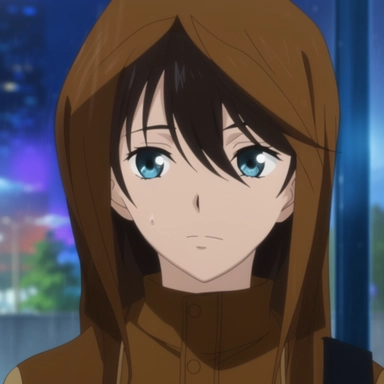
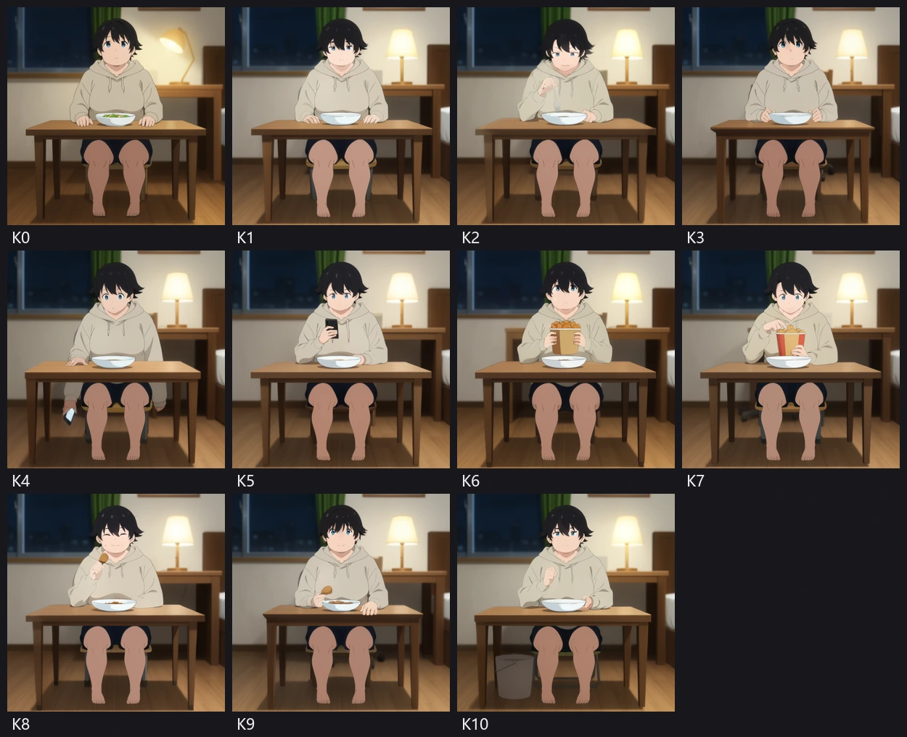

[English](README.md) · **简体中文**

# comfyui-apng-motion

[](https://github.com/Gg22333/comfyui-apng-motion/actions/workflows/ci.yml)
[](https://github.com/Gg22333/comfyui-apng-motion/releases)
[](LICENSE)
[](pyproject.toml)

在 ComfyUI 里用 **3–8 个关键帧 + latent 插值**做**能讲故事的 APNG / WebP / GIF**。
同一个工作流，**8 / 24 / 30 / 60 帧**随便切；SDXL 与 Moss/DiT 两套环境都有可直接导入的 JSON。
不靠 `batch_size` 堆帧，不逐帧落盘，一次 Queue 出三个成品文件。





---

## 目录

- [一眼看懂](#一眼看懂)
- [模型支持](#模型支持)
- [帧数怎么选](#帧数怎么选)
- [工作流](#工作流)
- [提示词怎么写](#提示词怎么写)
- [动作库](#动作库)
- [可调参数](#可调参数)
- [为什么不用 batch_size](#为什么不用-batch_size)
- [为什么省算力](#为什么省算力)
- [快速开始](#快速开始)
- [成品落在哪](#成品落在哪)
- [依赖](#依赖)
- [仓库结构](#仓库结构)
- [工作原理](#工作原理)
- [文档](#文档)
- [限制](#限制)
- [贡献](#贡献)
- [致谢](#致谢)
- [许可](#许可)

---

## 一眼看懂

| | |
| --- | --- |
| **输入** | 3–5 个关键帧提示词，写成一张「剧情卡」（主体锁定 + 画风锁定 + 每拍动作） |
| **引擎** | ComfyUI + `LatentInterpolate` ×N + `ImageBatchMulti(N)` |
| **输出** | APNG、WebP、GIF 各一个文件；8 / 12 / 24 / 30 / 60 帧；无限循环 |
| **模型** | 不限：SDXL checkpoint 或 Moss/DiT 三件套都可以（只认结构不认模型名） |
| **脚本** | 纯标准库 + Pillow，工具链不需要 GPU |
| **平台** | Windows / macOS / Linux，路径全部来自 `profiles/*.json` |

## 模型支持

工作流的结构契约与模型无关：**1 个 `denoise=1.0` 的 KSampler + 2–4 个关键帧 KSampler +
N 个 `LatentInterpolate` + N 个 `VAEDecode` + `ImageBatchMulti(N)` + 3 个保存节点**，N 就是帧数
（`--frames`，8–60）。换模型只换加载器，不动结构；`emit_workflow.py` 会自动把插值 / 解码 / 合批
三件套扩缩到 N。

| 模型族 | 加载器 | 关键帧 denoise | 说明 |
| --- | --- | --- | --- |
| SD 1.5 | `CheckpointLoaderSimple` | 0.45–0.55 | 原生 512×512 |
| SDXL / Illustrious / NoobAI | `CheckpointLoaderSimple` | 0.35–0.45 | 原生 1024×1024，512 也能跑 |
| FLUX.1 | `UNETLoader` + `DualCLIPLoader` + `VAELoader` | 0.45–0.55 | 采样器前加 `FluxGuidance` |
| Moss / DiT | `UNETLoader` + `CLIPLoader`（`type=moss_image`）+ `VAELoader` | 0.82–0.90 | 8 步 DMD，cfg 1.0；低于 0.80 关键帧几乎不动（整片相邻帧差 0.03），0.85 起动作才出得来；漂移靠同 seed、同首帧 latent、固定光照压住 |
| 任意微调模型 | 跟随其基座 | 先 0.35 | 越低越稳，越高越自由 |

denoise 区间是实拍经验，不是硬性规格。同 seed 下 **SDXL 的稳定上限约 0.35**：
超过 0.42 后关键帧重绘会开始改衣服和背景，latent 插值再把两套纹理混成色斑。
要更大表情就提 denoise 并接受漂移，或者只对面部做局部重绘。

## 帧数怎么选

帧数是参数，不是另一套方法。`--frames 8|12|24|30|60`（或剧情卡里的 `"frames"`）会把
`LatentInterpolate` / `VAEDecode` / `ImageBatchMulti` 重建成 N 个；`--segs` 决定 N 怎么分到每一拍，
不给就平均分。

| 帧数 | fps | 时长 | 适合 | 4 拍 segs 示例 |
| --- | --- | --- | --- | --- |
| 8 | 8 | 1.0 s | 头像微动、聊天气泡 | `2,2,2,2` |
| 12 | 12 | 1.0 s | 轻量贴纸 | `3,3,3,3` |
| 24 | 10 | 2.4 s | 默认；表情循环 | `6,7,6,5` |
| 30 | 15 | 2.0 s | 五拍故事、半身动作 | `8,8,7,7` |
| 60 | 30 | 2.0 s | 网页/Discord 顺滑预览、十一拍小故事 | `5,5,4,7,6,7,5,6,5,5,5` |

不管选哪一行，采样次数都还是 K 次（每个关键帧一次），只有解码次数和文件体积随 N 线性增长。
同内容下 60 帧 APNG 约为 24 帧的 2.5 倍；画面细节越多单帧越大，实测雨夜 60 帧 APNG 为 17 MB。见 [docs/formats.md](docs/formats.md)。
上面是 **60 帧 / 30fps / Moss-DiT** 的十一拍故事《减肥破功》：坐直立志 → 肩塌 → 趴桌 → 抬头看地板 →
侧身够手机 → 低头看屏 → 抱炸鸡桶 → 伸手进桶 → 举鸡腿偷吃 → 放下 → 扶住沙拉碗握拳「明天再减」。
配方在 [`assets/story.diet.json`](assets/story.diet.json)，`prompt_mode: moss_zh`，
节拍 `5,5,4,7,6,7,5,6,5,5,5`，denoise 0.85，640×640。
每拍之间由 `LatentInterpolate` 补过渡帧，关键帧在时间线上只出现一次，接缝不会停一帧；
分帧方法见 [docs/workflows.md](docs/workflows.md#过渡帧怎么排)。
下面那张联系表是按 `--segs` 从成片里抽出来的真实关键拍，不是示意图。

## 动作库

`assets/motion-presets.json` 带 17 组可直接用的动作节拍：9 组情绪（大笑 / 大哭 / 震惊 / 生气 / 得意 / 无语 / 慌张 / 困 / 比心）、
5 组动作（打招呼 / 点头 / 摇头 / 点赞 / 思考）、2 组五拍小故事（雨天出门 / 早八续命）、1 组十一拍全身故事（减肥破功，`moss_zh` 中文散文）。
`scripts/make_story.py` 把它们和你的角色锁定句拼成剧情卡，再交给 `emit_workflow.py`：

```bash
python scripts/make_story.py --list
python scripts/make_story.py --preset laugh --lock "masterpiece, 1girl, silver hair, blue eyes" --out story.laugh.json
python scripts/make_story.py --preset rainy-walk --lock "masterpiece, 1girl" --frames 60 --fps 30 --out story.rain.json
```

动作语法、平台规格（Telegram 512/≤3 秒/60fps、LINE APNG 5–20 帧/≤4 秒/≤1 MB、微信 GIF 240²/≤500 KB）
与七个常见翻车点见 [docs/motion-presets.md](docs/motion-presets.md)。

## 可调参数

下面这些都能在 ComfyUI 里直接改，不需要跑脚本。

| 范围 | 节点 | 控制什么 |
| --- | --- | --- |
| 全片 | `CLIPTextEncode`「全局动作指导」 | 动作、镜头、光照、风格；改一处，所有关键帧生效 |
| 每帧 | `CLIPTextEncode`「K0 / K1 / … 提示」 | 表情、姿态、视线 |
| 每帧采样 | 每个 `KSampler` | seed、steps、cfg、采样器、调度器、denoise |
| 节奏 | N 个 `LatentInterpolate` 的 ratio | 缓动曲线；`linear` 最均匀 |
| 速度 | 三个保存节点的 `fps` | 三处必须一致；`fps × 帧数` = 时长（24 帧 @12fps = 2.0 秒） |
| 提示词方言 | `--prompt-mode tags|moss_zh` | `tags` = SDXL 英文标签；`moss_zh` = MOSS 中文散文 |
| 尺寸 | latent 节点的宽高 / `--size 640` | Moss 512 或 640；SDXL 512–1024 |
| 命名 | `filename_prefix` | `apng/`、`webp/`、`gif/` 子目录 |
| 画质 | APNG `compress_level`、WebP `lossless`/`quality`、VHS `loop`/`pingpong` | 体积与播放行为 |

工作流里自带一个 `Note` 节点，把这张表写在画布上，不用翻文档找旋钮。

## 工作流

五份 JSON，拖进 ComfyUI 就能跑：

| 环境 | 3 拍 | 4 拍 |
| --- | --- | --- |
| SDXL | [`workflow-sdxl.json`](workflows/workflow-sdxl.json) | [`workflow-sdxl-4beat.json`](workflows/workflow-sdxl-4beat.json) |
| Moss / DiT | [`workflow-moss.json`](workflows/workflow-moss.json) | [`workflow-moss-4beat.json`](workflows/workflow-moss-4beat.json) |

画布上自带两个 `Note`：一个是「可调参数清单」，一个是「提示词写法（SDXL / MOSS 两套）」，
两套编码器的写法和帧数表都写在节点里，不用翻文档。
下载页与导入细节：[docs/workflows.md](docs/workflows.md)。

## 提示词怎么写

两套编码器手感完全不同，别混。

**SDXL / 传统 CLIP（`tags`）**

```
1girl, solo, full body, black short hair, blue eyes, beige hoodie,
dark shorts, barefoot, bedroom at night, warm lamp light,
〈这一拍动作〉,
anime screencap, clean lineart, flat cel shading
```

- 英文逗号分隔，重要标签往前放。
- 画风放最后：CLIP 对末尾 token 权重最高，写在中段会被动作词冲掉。
- 写画面不写效果：`eyes wide, pupils small` 而不是 `shocked`。
- 负向单独一个 `CLIPTextEncode`。

**MOSS / Qwen-VL（`moss_zh`）**

```
一间温馨的小卧室，深夜。画面右侧有一盏暖色台灯，光从右前方斜照下来，落在木地板上。
固定机位，平视，全身镜头，人物从头到脚完整入画，双手和双脚都留在画框里。
小满：黑色短发，蓝色眼睛，身材微胖，穿着宽松的米色连帽卫衣和深色短裤，赤脚。
小满盘腿坐在矮桌前，背挺得很直，双手叉在腰上，抬起下巴，嘴角只上扬几毫米。
动漫赛璐璐风格，干净黑色线稿，平涂上色，暖色调，柔和阴影。
```

- 中文散文，换行分段，每段以「。」结尾。
- 不堆 quality tag：`masterpiece` / `best quality` 对它是噪声。
- 用可测量的身体描述：`震惊 = 双眼睁大、瞳孔缩小、嘴张开`。
- 构图写死：固定机位、平视、全身镜头、从头到脚完整入画。
- 负向用中文。

完整十一拍范例：[`assets/story.diet.json`](assets/story.diet.json)；
`python scripts/make_story.py --preset diet-betrayal --out my.json` 可以直接生成。

## 为什么不用 batch_size

`batch_size=24` 是 **24 个互相独立的噪声样本**。固定 seed 只保证可复现，不会让它们变成连续帧，
播放必然闪。本项目的做法是把每个关键帧都锚在**同一份首帧 latent** 上，发色、瞳色、构图都不漂：

```
首帧（denoise 1.0，固定 seed）
   ├─ 关键帧 A（从首帧 latent 重绘，denoise 0.4/0.5）
   ├─ 关键帧 B …（同一份 latent）
   └─ 关键帧 C …（可选，做 4–5 拍）
N × LatentInterpolate → N × VAEDecode → ImageBatchMulti(N)
   ├─ SaveAnimatedPNG
   ├─ SaveAnimatedWEBP
   └─ VHS_VideoCombine（GIF）
```

## 为什么省算力

一次只花 **K 次采样，不是 N 次**——帧数怎么改都不影响这一条：

| 拍数 | 采样次数（steps=20） | 相对 24 帧逐帧（480 次） | 相对 60 帧逐帧（1200 次） |
| --- | --- | --- | --- |
| 3 拍 | 3 × 20 = 60 | 少 87.5% | 少 95.0% |
| 4 拍 | 4 × 20 = 80 | 少 83.3% | 少 93.3% |
| 5 拍 | 5 × 20 = 100 | 少 79.2% | 少 91.7% |

所以从 24 帧加到 60 帧，**采样成本一点没涨**；随 N 增长的只有 VAE 解码次数和文件体积。

解码仍然是 N 次，但插值只是 N 次 `64×64×4` latent 线性混合，不调用模型，占用是几十 MB 级缓冲而不是几 GB。代价是没有真实运动轨迹；换来的是采样成本降到零头、成品到处能播。

和 Live2D / Spine、视频生成、序列帧、Lottie 的完整对比：[docs/synthesis-comparison.md](docs/synthesis-comparison.md)。

## 快速开始

```powershell
git clone https://github.com/Gg22333/comfyui-apng-motion.git
cd comfyui-apng-motion

python scripts/detect_env.py      # 扫本机 ComfyUI，写 profiles/
python scripts/doctor.py          # 体检模型、插件、端口、输出目录
python scripts/emit_workflow.py --base workflows/workflow-sdxl.json --story assets/story.4beat.json --out my-4beat.json
```

把 `my-4beat.json` 拖进 ComfyUI，改提示词，Queue。
成品在 `output/APNG/final/{apng,webp,gif}/`，一次 Queue 三个文件。
检查目录结构、归档游离文件：

```powershell
python scripts/check_output.py --profile profiles/xl.json
python scripts/check_output.py --profile profiles/xl.json --fix
```

不开界面（校验 + 提交 + 自动验片）：

```powershell
python scripts/emit_workflow.py --validate my-4beat.json --run --profile profiles/xl.json
```

## 依赖

| 依赖 | 版本 | 必需 | 缺了会怎样 |
| --- | --- | --- | --- |
| Python | ≥ 3.9 | 是 | 脚本跑不起来 |
| Pillow | ≥ 9.0 | 仅校验 | `check_anim.py` 不可用，出片不受影响 |
| ComfyUI | ≥ 0.3 | 是 | 没有 `SaveAnimatedPNG` / `SaveAnimatedWEBP` |
| [comfyui-kjnodes](https://github.com/kijai/ComfyUI-KJNodes) | 任意 | 是 | `ImageBatchMulti` 爆红 |
| [ComfyUI-VideoHelperSuite](https://github.com/Kosinkadink/ComfyUI-VideoHelperSuite) | 任意 | 否 | 只少 GIF |

```powershell
python scripts/check_deps.py
pip install -r requirements.txt
```

建议用 ComfyUI 自带的 Python 跑校验——它已经装了 Pillow。

## 仓库结构

```
SKILL.md              完整方法（原理 / 剧情卡 / 多角色 / 排错 / 移植）
skill.json            版本、依赖、入口、安装目标
scripts/              探测、体检、生成工作流、动作库→剧情卡、校验成品、曲线、安装、打包
workflows/            可直接导入的工作流（SDXL + Moss，各 3/4 拍）
assets/               17 组动作库、剧情卡（含 moss_zh 故事卡）、节点定义兜底
docs/                 中文文档；英文在 docs/en/
tests/                离线单测（不联网、不用 GPU）
profiles/             每台机器生成（已 gitignore）
dist/                 打包产物（已 gitignore）
```

## 工作原理

1. **关键帧**：首帧 txt2img；其余关键帧都从首帧 latent 做 img2img。
2. **插值**：24 个 `LatentInterpolate` 沿缓入缓出曲线在关键帧之间走。
3. **解码与合批**：24 次解码合成一个 batch，三个编码器读同一份 batch。
4. **验片**：`check_anim.py` 报告帧数、时长、循环、相邻帧差异与颜色漂移。

曲线取值、Pillow 为什么会合并相同帧、GIF 为什么是 1/100 秒，见
[docs/formats.md](docs/formats.md) 与 [SKILL.md](SKILL.md)。

## 文档

| | 中文 | English |
| --- | --- | --- |
| 总览 | [docs/index.md](docs/index.md) | [docs/en/index.md](docs/en/index.md) |
| 安装 | [docs/install.md](docs/install.md) | [docs/en/install.md](docs/en/install.md) |
| 用法 | [docs/usage.md](docs/usage.md) | [docs/en/usage.md](docs/en/usage.md) |
| 工作流 | [docs/workflows.md](docs/workflows.md) | [docs/en/workflows.md](docs/en/workflows.md) |
| 动作库（17 组） | [docs/motion-presets.md](docs/motion-presets.md) | [docs/en/motion-presets.md](docs/en/motion-presets.md) |
| 成品落盘 | [docs/output.md](docs/output.md) | [docs/en/output.md](docs/en/output.md) |
| 方案对比 | [docs/synthesis-comparison.md](docs/synthesis-comparison.md) | [docs/en/synthesis-comparison.md](docs/en/synthesis-comparison.md) |
| 格式对比 | [docs/formats.md](docs/formats.md) | [docs/en/formats.md](docs/en/formats.md) |
| 架构 | [docs/architecture.md](docs/architecture.md) | [docs/en/architecture.md](docs/en/architecture.md) |
| 排错 | [docs/troubleshooting.md](docs/troubleshooting.md) | [docs/en/troubleshooting.md](docs/en/troubleshooting.md) |
| FAQ | [docs/faq.md](docs/faq.md) | [docs/en/faq.md](docs/en/faq.md) |

## 成品落在哪

一次 Queue 只往 **ComfyUI 自己的 `output/`** 写三个成品，不写进仓库：

```
<ComfyUI>/output/APNG/final/
├─ apng/anim24_00001_.png      # 无损 APNG，首帧可当静态图
├─ webp/anim24_00001_.webp     # 透明、体积最小
└─ gif/anim24_00001.gif        # 聊天用
   └─ anim24_00001.png         # VHS 首帧预览，可删
```

三条硬规则：

1. 三个保存节点接**同一个** `ImageBatchMulti` 输出；工作流里不放 `SaveImage` / `PreviewImage`。
2. 三个节点各用各的前缀：`APNG/final/apng|webp|gif/anim24`。
3. 改完前缀必须 **F5 刷新**再 Queue。前端会缓存旧值，旧前缀就是成品落到 `output/APNG/` 根目录的原因。

上面名字里的 `anim24` 是剧情卡 `name` 字段，换帧数时改成 `anim60` 之类即可，三个保存节点共用同一个前缀根。

没有同批 WebP/GIF 的单张 PNG，只是半次运行或旧前缀残留，不是成品。
`check_output.py` 会报 `stray_root`、`incomplete`、`outside_apng`，并识别正常的 `vhs_sidecar`；加 `--fix` 把游离文件移进 `output/APNG/archive/stray-<时间戳>/`。

仓库和 skill 目录里不放任何成品，也不放原始 APNG；`docs/assets/` 只有 `make_preview.py` 与 `make_storyboard.py` 生成的网页素材。
细则：[docs/output.md](docs/output.md)。

## 限制

- latent 插值**没有真实运动轨迹**：适合表情、呼吸、轻微头部动作；不适合走位、转身、镜头运动。
  这类需求要上 ControlNet 骨骼序列或视频模型（Wan / LTX）。
- 帧数是预算，不是画质旋钮：8–60 帧都能跑，解码耗时随 N 线性增长。24 帧是默认甜点，
  60 帧用来做 30fps 下 2 秒的叙事节拍。帧数再多也不会变出新姿势——它平滑的是过渡，不是轨迹。
- APNG 体积偏大（每帧整帧 PNG）。聊天发 GIF，要透明发 WebP。

## 贡献

见 [CONTRIBUTING.md](CONTRIBUTING.md) 与 [CODE_OF_CONDUCT.md](CODE_OF_CONDUCT.md)。提 PR 前先跑 `pytest -q`。

## 致谢

基于 ComfyUI、[ComfyUI-KJNodes](https://github.com/kijai/ComfyUI-KJNodes)、
[ComfyUI-VideoHelperSuite](https://github.com/Kosinkadink/ComfyUI-VideoHelperSuite)。
仓库结构参考 [book-to-skill](https://github.com/virgiliojr94/book-to-skill)。

## 许可

MIT，见 [LICENSE](LICENSE)。
