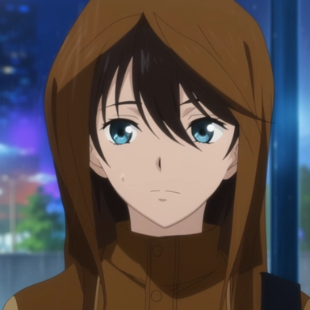

# comfyui-apng-motion

A ComfyUI skill and toolkit for **24-frame, coherent APNG / WebP / GIF** animations.



> The primary preview is WebP (true colour, about 1/5 the size of GIF); `preview.gif` remains for
> chat apps. The GIF is re-encoded with one global palette and dithering off, so 256-colour
> quantisation no longer reads as flicker. See [formats](formats.md#46-why-the-web-preview-is-webp).

## What it fixes

| Common approach | Result |
| --- | --- |
| `batch_size=24` | 24 independent noise samples; playback flickers, a fixed seed does not help |
| Frame-by-frame inheritance | Motion is smooth, but hair and eye colour drift across frames |
| Saving every frame | The output folder fills with hundreds of PNGs |

This project instead: **sample the first frame once → redraw every keyframe from that same first latent → interpolate 24 latents → decode 24 times → merge → write three files.**

## Three steps

```bash
python scripts/detect_env.py
python scripts/doctor.py
python scripts/emit_workflow.py --base assets/workflow-sdxl.json --story assets/story.4beat.json --out my.json
```

## More

- [Install](install.md)
- [Usage](usage.md)
- [Output layout](output.md)
- [Approach comparison: APNG / GIF / Live2D / video](synthesis-comparison.md)
- [APNG, GIF and video-to-GIF](formats.md)
- [Architecture](architecture.md)
- [Troubleshooting](troubleshooting.md)
- [FAQ](faq.md)
