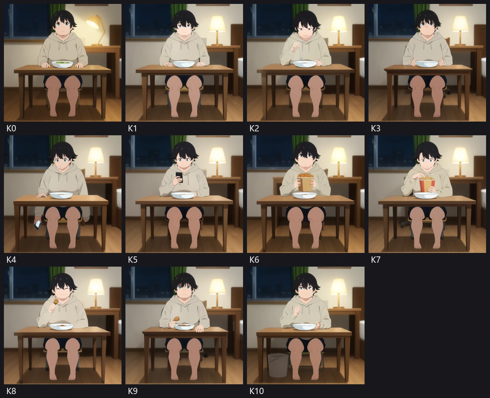

# comfyui-apng-motion

ComfyUI 里做 **能讲故事的 APNG / WebP / GIF**：3–8 个关键帧 + latent 插值，
同一个工作流切 **8 / 24 / 30 / 60 帧**，SDXL 与 Moss/DiT 两套环境都有可导入的 JSON。

[English](en/index.md) · **简体中文**




> 预览：60 帧 / 30fps / Moss-DiT 六拍故事《减肥破功》，配方是 `assets/story.diet.json`（`prompt_mode: moss_zh`）。
> 下面的联系表是按 segs 从成片抽出的真实关键拍。
> 网页主预览用 WebP q100（真彩、保住 60 帧；libwebp 在 q90 会把近重复帧并成 58 帧）；`preview.gif` 保留给聊天工具。
> GIF 用全局固定调色板 + 关抖动重编码，避免 256 色量化造成的色块闪动。细节见[格式对比](formats.md#46-网页预览为什么最终用-webp)。

## 它解决什么

| 错误做法 | 后果 |
| --- | --- |
| `batch_size=24` | 24 个独立噪声，播放必闪；固定 seed 也救不了 |
| 逐帧继承上一帧 | 动作顺了，但发色/瞳色会累积漂移 |
| 每帧都存图 | 输出目录被几百张 PNG 塞满 |

本项目的做法：**首帧一次采样 → 关键帧全部从同一份首帧 latent 重绘 → N 个 latent 插值 → N 次解码 → 合并 → 三个成品文件。**

## 三步

```bash
python scripts/detect_env.py
python scripts/doctor.py
python scripts/emit_workflow.py --base workflows/workflow-sdxl.json --story assets/story.4beat.json --out my.json
```

## 进一步

- [安装](install.md)
- [用法](usage.md)（含 [帧数怎么选](usage.md)、[提示词怎么写](workflows.md#提示词写法)）
- [工作流：五份可直接导入的 JSON](workflows.md)
- [动作库：17 组表情包动作](motion-presets.md)
- [成品落盘](output.md)
- [方案对比：APNG / GIF / Live2D / 视频](synthesis-comparison.md)
- [APNG、GIF 与视频转 GIF](formats.md)
- [架构](architecture.md)
- [排错](troubleshooting.md)
- [FAQ](faq.md)
- [发布](publishing.md)


